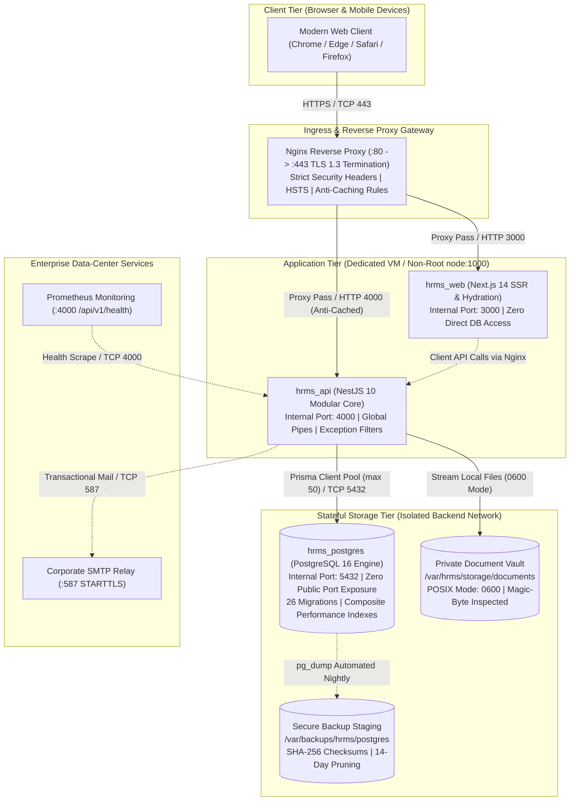

# PeopleOS HRMS — Complete System Architecture

**Document ID:** `ARCH-SYSTEM-001`  
**Phase:** 18 — Final HRMS UAT, Documentation, Release Validation & Sign-Off  
**Target Environment:** Private Enterprise Data Center  
**Classification:** Confidential — Engineering Architecture Standard

---

## 1. System Vision & Architectural Principles

PeopleOS HRMS is an enterprise-grade, self-hosted Human Resource Management System built specifically for organizations requiring full data sovereignty on private data-center infrastructure.

### Architectural Core Principles

1. **Modular Monolith**: A unified codebase organized strictly by clear domain module boundaries. High cohesion, low coupling, zero premature distributed-network complexity.
2. **Zero Cloud Rent / Complete Data Sovereignty**: No mandatory SaaS dependencies, external cloud subscriptions, or vendor-locked APIs. Runs completely on Linux, Docker, and PostgreSQL 16.
3. **Defense-in-Depth Security**: Multi-tier authentication (Argon2, short-lived JWT, secure cookies), server-side RBAC, ownership scope verification, in-memory financial streaming, and POSIX `0600` document storage vaults.
4. **Resilient Data Operations**: Relational integrity with 26 linear Prisma migrations, composite performance indexes, deterministic state machines, and tested disaster recovery procedures.

---

## 2. Global Topology & Logical Architecture



---

## 3. Monorepo Structure & Package Boundaries

```
├── apps/
│   ├── api/                  # NestJS 10 Modular Backend (/api/v1/...)
│   └── web/                  # Next.js 14 Web Frontend (SSR + Client Hydration)
├── packages/
│   ├── config/               # Shared tokens, navigation & environment constants
│   ├── database/             # Prisma schema, migrations, seed & client
│   ├── eslint-config/        # Shared linting configuration
│   ├── types/                # Shared TypeScript models & API envelopes
│   └── ui/                   # Reusable HRMS design system & component library
├── infrastructure/
│   ├── docker/               # Production & Dev Dockerfiles & compose
│   ├── monitoring/           # Prometheus scraping & alerting rules
│   ├── nginx/                # Nginx reverse proxy configuration
│   ├── postgres/             # PostgreSQL init scripts & extensions
│   └── scripts/              # Automated backup-db.sh, restore-db.sh, rollback-app.sh
└── docs/                     # System architecture & engineering documentation
```

---

## 4. Four Core User Personas & Scoping

1. **`ADMIN`**: Global organization governance, system settings, role assignment, audit log explorer, and security configuration.
2. **`HR`**: Organization-wide employee directory, attendance anomaly queues, leave policy ledgers, MIS analytics, and the enterprise payroll calculation engine.
3. **`MANAGER`**: Team roster oversight, direct report request approvals (leave, WFH, official visits), and performance review assessments.
4. **`EMPLOYEE`**: Self-service profile, daily check-in (Office, WFH, OD), leave applications, goal tracking, and personal digital payslips.

---

## 5. Security & Privacy Architecture

- **Stateless Tokens with Cookie Storage:** 15-minute access tokens paired with 7-day refresh tokens stored in `httpOnly`, `Secure`, `SameSite=Lax` cookies.
- **In-Memory Streaming:** Generated payslips are rendered on-the-fly via `pdfkit` directly into binary `Buffer` streams, ensuring private financial data is never saved to unencrypted temporary files on disk.
- **Zero Database Exposure:** The PostgreSQL container maps zero host ports in production, communicating strictly over an internal Docker bridge (`backend_net: internal=true`).
