# PeopleOS HRMS — Data-Center CI/CD Pipeline & Build Automation

**Document ID:** `CICD-SPEC-012`  
**Phase:** 17 — Production Data-Center Deployment, DevOps, Backups & Disaster Recovery  
**Target Environment:** Private Organizational Data Center  
**Classification:** Confidential — Internal Operational Standard

---

## 1. CI/CD Architecture & Private Data-Center Constraints

In an on-premises data-center environment protected by Network Access Control (NAC), public cloud CI/CD runners (e.g., standard GitHub-hosted runners) cannot connect directly to internal application VMs or database clusters.

To preserve security, PeopleOS implements an **Air-Gapped / Internal Runner Architecture**:

- **Source Control:** Internal GitLab Server or GitHub Enterprise Server.
- **CI/CD Execution:** Self-hosted internal runners running inside the Data Center Management VLAN.
- **Container Registry:** Internal enterprise registry (e.g., VMware Harbor or Sonatype Nexus).
- **Deployment Control:** Automated builds and tests with **Mandatory Manual Approval** for staging and production deployments.

---

## 2. CI/CD Pipeline Stages

```mermaid
flowchart LR
    subgraph Stage1 ["Stage 1: Validation"]
        Lint["Lint & Format Check\n(pnpm run lint)"]
        Typecheck["TypeScript Compilation\n(pnpm run typecheck)"]
        Test["Automated Test Suites\n(1,133+ Tests Passing)"]
    end

    subgraph Stage2 ["Stage 2: Build & Security"]
        Build["Production Build\n(turbo run build)"]
        Audit["Dependency Audit\n(pnpm audit --prod)"]
        Container["Container Build & Trivy Scan\n(Dockerfile.api, Dockerfile.web)"]
    end

    subgraph Stage3 ["Stage 3: Staging Deploy"]
        DeployStaging["Deploy to Staging VM\n(Auto on 'main')"]
        SmokeStaging["E2E Health & Smoke Tests"]
    end

    subgraph Stage4 ["Stage 4: Production Gate"]
        ManualGate{"Manual Production Approval\n(CAB + Tech Lead)"}
        BackupProd["Pre-Deploy DB Snapshot"]
        DeployProd["Rolling Deploy to Production VM"]
        VerifyProd["Post-Release Smoke Tests"]
    end

    Stage1 --> Stage2
    Stage2 --> Stage3
    Stage3 --> ManualGate
    ManualGate --> BackupProd
    BackupProd --> DeployProd
    DeployProd --> VerifyProd
```



---

## 3. Pipeline Implementation Blueprint

Below is the production-grade pipeline specification for internal GitLab CI or self-hosted GitHub Actions:

### 3.1 GitLab CI Specification (`.gitlab-ci.yml`)

```yaml
stages:
  - validate
  - build
  - security
  - deploy-staging
  - deploy-production

variables:
  INTERNAL_REGISTRY: 'registry.internal.corp/hrms'
  DOCKER_DRIVER: overlay2

default:
  tags:
    - datacenter-runner # Self-hosted internal runner

# ------------------------------------------------------------------------------
# 1. Validation Stage
# ------------------------------------------------------------------------------
lint-and-typecheck:
  stage: validate
  image: node:20-alpine
  script:
    - npm install -g pnpm@12.8.1
    - pnpm install --frozen-lockfile=false
    - pnpm run format:check
    - pnpm run lint
    - pnpm run typecheck

unit-and-integration-tests:
  stage: validate
  image: node:20-alpine
  script:
    - npm install -g pnpm@12.8.1
    - pnpm install --frozen-lockfile=false
    - pnpm run test

# ------------------------------------------------------------------------------
# 2. Build & Container Security Stage
# ------------------------------------------------------------------------------
build-and-scan-images:
  stage: build
  script:
    - docker build -t ${INTERNAL_REGISTRY}/api:${CI_COMMIT_SHA} -f infrastructure/docker/Dockerfile.api .
    - docker build -t ${INTERNAL_REGISTRY}/web:${CI_COMMIT_SHA} -f infrastructure/docker/Dockerfile.web .
    # Scan for vulnerabilities using Trivy
    - trivy image --exit-code 1 --severity CRITICAL ${INTERNAL_REGISTRY}/api:${CI_COMMIT_SHA}
    - trivy image --exit-code 1 --severity CRITICAL ${INTERNAL_REGISTRY}/web:${CI_COMMIT_SHA}
    # Push to internal registry
    - docker push ${INTERNAL_REGISTRY}/api:${CI_COMMIT_SHA}
    - docker push ${INTERNAL_REGISTRY}/web:${CI_COMMIT_SHA}

# ------------------------------------------------------------------------------
# 3. Pre-Production Staging Deployment
# ------------------------------------------------------------------------------
deploy-to-staging:
  stage: deploy-staging
  rules:
    - if: '$CI_COMMIT_BRANCH == "main"'
  script:
    - ssh deployer@staging-app.internal.corp "
      cd /opt/hrms &&
      docker compose -f docker-compose.staging.yml pull &&
      docker compose -f docker-compose.staging.yml up -d --remove-orphans &&
      docker compose -f docker-compose.staging.yml exec -T api npx prisma migrate deploy &&
      curl -f http://localhost:4000/api/v1/health
      "

# ------------------------------------------------------------------------------
# 4. Production Deployment Gate (Strict Manual Approval)
# ------------------------------------------------------------------------------
deploy-to-production:
  stage: deploy-production
  when: manual # Requires explicit human sign-off
  rules:
    - if: '$CI_COMMIT_TAG =~ /^v[0-9]+\.[0-9]+\.[0-9]+$/'
  script:
    - ssh deployer@prod-app.internal.corp "
      cd /opt/hrms &&
      bash infrastructure/scripts/backup-db.sh &&
      docker compose -f docker-compose.prod.yml pull &&
      docker compose -f docker-compose.prod.yml up -d --remove-orphans &&
      docker compose -f docker-compose.prod.yml exec -T api npx prisma migrate deploy &&
      curl -f http://localhost:4000/api/v1/health
      "
```

---

## 4. Security Principles Enforced by CI/CD

1. **Immutable Artifacts:** Every build tags Docker images with the exact Git commit SHA and semantic release version (`v1.17.0`).
2. **Zero Insecure Code Merge:** Branch protection on `main` requires all 1,133 tests and type checks to pass before merging.
3. **No Embedded Secrets in Images:** The build step copies no `.env` files into container layers.
4. **Air-Gapped Operation:** All dependencies are cached or pulled from the local enterprise npm mirror (Verdaccio/Nexus) inside the data center.
