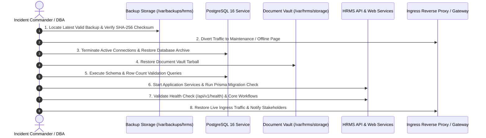

# PeopleOS HRMS — Disaster Recovery & System Restoration Runbook

**Document ID:** `DR-RUNBOOK-007`  
**Phase:** 17 — Production Data-Center Deployment, DevOps, Backups & Disaster Recovery  
**Target Environment:** Private Organizational Data Center  
**Target RTO:** ≤ 2 Hours | **Target RPO:** ≤ 1 Hour  
**Classification:** Confidential — Emergency Operational Playbook

---

## 1. Disaster Recovery Trigger & Classification

This runbook is initiated upon declaration of a critical incident by the Incident Commander or Infrastructure Lead.

### Severity Levels:

- **Severity 1 (Total Site / Host Failure):** Physical server failure, total VM corruption, or catastrophic SAN volume loss requiring rebuilding on a standby node.
- **Severity 2 (Data Corruption / Failed Release):** Database logical corruption, malicious data deletion, or failed unrecoverable schema migration requiring database point-in-time recovery.

---

## 2. Emergency Operational Sequence



---

## 3. Step-by-Step Restoration Protocol

### Phase 1: Ingress Isolation & Maintenance Mode

To prevent partial data writes during restoration, isolate ingress traffic:

```bash
# Display temporary maintenance message to end users:
sudo cp /etc/nginx/maintenance.html /var/www/html/index.html
# Route Nginx or Load Balancer to maintenance page (HTTP 503 Service Unavailable)
```

### Phase 2: Backup Archive Identification & Integrity Check

Locate the most recent valid backup file on local or off-site backup storage:

```bash
cd /var/backups/hrms/postgres

# List available snapshots in reverse chronological order:
ls -lh hrms_backup_*.sql.gz

# Select target backup and verify SHA-256 checksum:
TARGET_BACKUP="hrms_backup_20261013_020000.sql.gz"
sha256sum -c "${TARGET_BACKUP}.sha256"

# Expected output:
# hrms_backup_20261013_020000.sql.gz: OK
```

### Phase 3: Database Service Restoration

Execute the automated database restoration script:

```bash
# Execute safe restore script (terminates connections, drops dirty tables, restores schema + data):
bash infrastructure/scripts/restore-db.sh "/var/backups/hrms/postgres/${TARGET_BACKUP}"
```

### Phase 4: Document Vault Restoration

Restore the employee document directory to match the database metadata records:

```bash
cd /var/backups/hrms/documents

# Select synchronized document tarball:
TARGET_DOCS="hrms_docs_20261013_030000.tar.gz"
sha256sum -c "${TARGET_DOCS}.sha256"

# Extract archive into persistent document storage location:
sudo tar -xzf "${TARGET_DOCS}" -C /var/hrms/storage/

# Enforce secure POSIX ownership and permissions:
sudo chown -R 1000:1000 /var/hrms/storage/documents
sudo find /var/hrms/storage/documents -type d -exec chmod 700 {} +
sudo find /var/hrms/storage/documents -type f -exec chmod 600 {} +
```

### Phase 5: Database Consistency & Record Count Validation

Perform database sanity checks to ensure relational integrity:

```bash
docker exec -i hrms_postgres psql -U hrms_user -d hrms_db -c "
SELECT 'Organizations' as entity, count(*) as count FROM organizations
UNION ALL
SELECT 'Users', count(*) FROM users
UNION ALL
SELECT 'Employees', count(*) FROM employees
UNION ALL
SELECT 'Attendance Records', count(*) FROM attendance_records
UNION ALL
SELECT 'Leave Applications', count(*) FROM leave_applications
UNION ALL
SELECT 'Payroll Runs', count(*) FROM payroll_runs
UNION ALL
SELECT 'Employee Snapshots', count(*) FROM employee_payroll_snapshots
UNION ALL
SELECT 'Document Metadata', count(*) FROM employee_document_metadata;
"
```

### Phase 6: Application Reconnection & Startup

Start the core application services using the production compose configuration:

```bash
# Start backend API and web frontend:
docker compose -f docker-compose.prod.yml up -d --build

# Verify Prisma migration status aligns with restored database:
docker compose -f docker-compose.prod.yml exec api npx prisma migrate status

# Check container health status:
docker compose -f docker-compose.prod.yml ps
```

### Phase 7: Post-Restoration Workflow Smoke Testing

Verify the following 6 core functional workflows before opening traffic to general users:

1. **System Health Probe:**
   ```bash
   curl -s http://127.0.0.1:4000/api/v1/health | grep '"status":"ok"'
   ```
2. **User Authentication:** Log in with an administrative and an employee test account.
3. **Employee Directory:** Verify `/employees` list displays active employees without errors.
4. **Attendance Query:** Verify attendance dashboard and historical records render accurately.
5. **Payroll Integrity:** Open `/payroll/runs` and inspect historical locked runs. Confirm calculations remain immutable and matching previous period totals.
6. **Document Download:** Verify downloading a sample employee document from `/documents` renders the valid decrypted `.bin` file without corruption.

### Phase 8: Traffic Cutover & Incident Closure

1. Re-enable production routing in the reverse proxy / Load Balancer.
2. Confirm live end-user HTTP traffic succeeds with HTTP 200 responses.
3. Archive incident logs and compile the Post-Incident Review (PIR) report.
