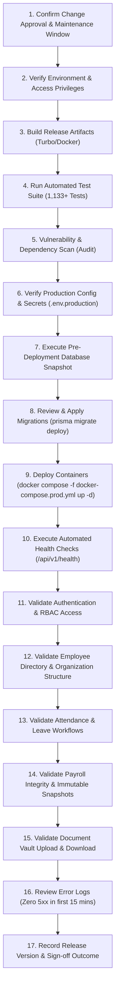

# PeopleOS HRMS — Standard Production Release Procedure

**Document ID:** `REL-PROC-010`  
**Phase:** 17 — Production Data-Center Deployment, DevOps, Backups & Disaster Recovery  
**Target Environment:** Private Organizational Data Center  
**Classification:** Confidential — Standard Operating Procedure (SOP)

---

## 1. Release Governance & Maintenance Window

All production deployments must follow this standardized 17-point release procedure. Releases must be scheduled within an approved maintenance window (typically Sundays between 02:00 and 04:00 UTC) with Change Advisory Board (CAB) approval.

---

## 2. 17-Point Release Execution Checklist

### Detailed Step Protocol:

| Step # | Task Name              | Exact Command / Procedure                                                                     | Pass Criteria                                        |
| :----: | :--------------------- | :-------------------------------------------------------------------------------------------- | :--------------------------------------------------- |
| **1**  | **Change Approval**    | Verify CAB change ticket ID and authorized release manager.                                   | Ticket in "Approved" state.                          |
| **2**  | **Environment Check**  | Verify host disk space (`df -h`) and host memory (`free -m`).                                 | ≥ 50 GB free disk space, ≥ 4 GB free RAM.            |
| **3**  | **Artifact Build**     | Build monorepo packages: `pnpm run build`.                                                    | Turbo reports 0 build errors.                        |
| **4**  | **Automated Tests**    | Execute comprehensive test suite: `pnpm run test`.                                            | 69 suites passed, 1,133+ tests green.                |
| **5**  | **Vulnerability Scan** | Scan dependencies: `pnpm audit --prod`.                                                       | Zero critical unpatched vulnerabilities.             |
| **6**  | **Secrets Check**      | Verify `.env.production` contains all mandatory secrets without defaults.                     | All required tokens populated (`chmod 600`).         |
| **7**  | **Database Snapshot**  | Run safety backup: `bash infrastructure/scripts/backup-db.sh`.                                | Non-empty `.sql.gz` + verified `.sha256`.            |
| **8**  | **Apply Migrations**   | Run: `docker compose -f docker-compose.prod.yml exec api npx prisma migrate deploy`.          | All migrations applied; `status` reports up to date. |
| **9**  | **Container Deploy**   | Run: `docker compose -f docker-compose.prod.yml up -d --build`.                               | All containers in `Up (healthy)` state.              |
| **10** | **Health Check**       | Probe: `curl -s http://127.0.0.1:4000/api/v1/health`.                                         | Response returns `"status":"ok"`, DB connected.      |
| **11** | **Auth Validation**    | Log in with test accounts across all 4 roles: `ADMIN`, `HR`, `MANAGER`, `EMPLOYEE`.           | Tokens issued; role gates respected.                 |
| **12** | **Employee Check**     | Verify `/employees` directory renders search and pagination.                                  | HTTP 200, active employee list displayed.            |
| **13** | **Attendance & Leave** | Verify check-in status query and leave balance queries.                                       | Correct balance calculations returned.               |
| **14** | **Payroll Integrity**  | Inspect `/payroll/runs`. Verify locked periods display immutable INR values.                  | Zero variance in historical payroll figures.         |
| **15** | **Document Vault**     | Verify authenticated download of a test `.bin` document.                                      | File streams with valid MIME type.                   |
| **16** | **Log Review**         | Tail logs for 15 minutes: `docker compose -f docker-compose.prod.yml logs -f --tail=200 api`. | Zero unhandled exceptions or 500 errors.             |
| **17** | **Sign-off**           | Record release tag (e.g., `v1.17.0`) and notify incident response team.                       | Release officially marked SUCCESS.                   |
