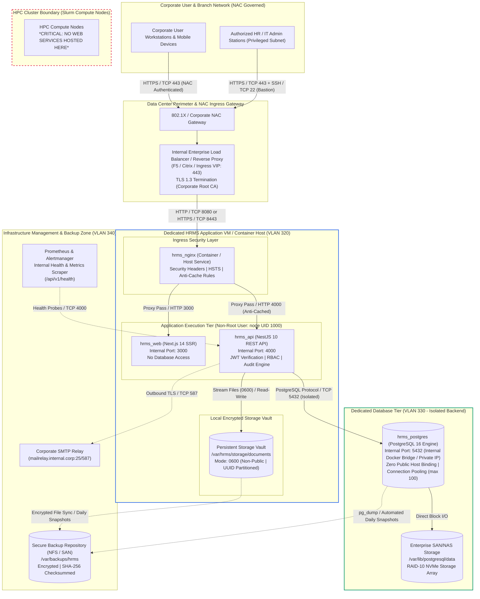

# PeopleOS HRMS — Production Target Architecture

**Document ID:** `ARCH-TARGET-002`  
**Phase:** 17 — Production Data-Center Deployment, DevOps, Backups & Disaster Recovery  
**Classification:** Confidential — Internal Operational Document  
**Target Environment:** Organization Private Data Center & HPC Facilities

---

## 1. Architectural Overview & Context

PeopleOS HRMS is an enterprise human resource management and payroll system designed for internal organizational operations. The target deployment site is our private corporate data center.

The data center hosts a High-Performance Computing (HPC) cluster alongside virtualization clusters. The infrastructure team enforces strict Network Access Control (NAC) and isolation policies. To provide high availability, zero cross-tenant contamination, and enterprise security, this document outlines the target production architecture, network zoning, trust boundaries, and platform deployment models.

---

## 2. Logical Architecture Diagram

---

## 3. HPC Cluster Analysis & Deployment Separation

### 3.1 Why the HPC Cluster Must Not Host the HRMS

The data-center infrastructure includes a High-Performance Computing (HPC) cluster managed by workload managers (e.g., Slurm, PBS Pro). An assessment of this environment reveals:

1. **Transient Job Scheduling:** Compute nodes in an HPC cluster are batch-scheduled. Nodes are allocated dynamically for parallel compute jobs and deallocated upon completion. Deploying persistent web daemons on compute nodes violates cluster resource scheduling.
2. **Ephemeral Node Filesystems:** Compute nodes typically run diskless or have ephemeral scratch space (`/scratch`, `/tmp`) formatted between jobs. Production PostgreSQL databases and document vaults require strictly persistent, high-IOPS storage.
3. **No Ingress Ports / No External IP Routing:** HPC compute nodes are on private, non-routable interconnects (e.g., InfiniBand or dedicated RoCE networks) inaccessible to general enterprise user subnets.
4. **No Root / Security Restrictions:** Running long-running container daemons, opening low privileged ports, and managing background web daemons without root or administrative privileges on shared HPC nodes is unfeasible and introduces severe security risks.

### 3.2 Approved Hosting Recommendation

The HRMS stack **must be deployed on a dedicated Enterprise Application Virtual Machine (VM)** or an **approved container cluster (Kubernetes / OpenShift)** provisioned on the data center's standard enterprise virtualization hypervisors (VMware vSphere / Proxmox VE / KVM) operating in parallel to the HPC cluster.

---

## 4. Component Responsibilities & Trust Boundaries

| Component                                 | Responsibility                                                                                                                        |         Trust Level          | Ingress Access                                                 | Egress Access                                         |
| :---------------------------------------- | :------------------------------------------------------------------------------------------------------------------------------------ | :--------------------------: | :------------------------------------------------------------- | :---------------------------------------------------- |
| **Corporate Reverse Proxy / Ingress VIP** | Terminates TLS (HTTPS 443), validates SSL certificates, enforces corporate WAF rules.                                                 |          High (DMZ)          | Port 443 from NAC-approved corporate clients                   | Forward to `hrms_nginx` (Port 80/8080/443)            |
| **Ingress Nginx (`hrms_nginx`)**          | Enforces HSTS, security headers, request body size limits (25MB), route segregation, and strict anti-caching for financial endpoints. |      Medium (App Zone)       | Port 80/443 from Load Balancer                                 | Forward to `hrms_web` (3000) & `hrms_api` (4000)      |
| **Web Frontend (`hrms_web`)**             | Next.js 14 SSR, renders UI shell, handles client hydration. Has **zero** database connectivity.                                       |    Low-Medium (App Zone)     | Port 3000 from `hrms_nginx`                                    | API calls to `hrms_api` (4000)                        |
| **Core API (`hrms_api`)**                 | NestJS 10, executes business logic, enforces RBAC, validates payroll state machines, streams documents.                               |       High (App Zone)        | Port 4000 from `hrms_nginx` and Prometheus                     | Outbound to PostgreSQL (5432) and SMTP relay (25/587) |
| **Document Vault**                        | Local filesystem storage (`/var/hrms/storage/documents`) holding employee verification files.                                         |        High (Storage)        | Accessible **only** by `hrms_api` process (`mode: 0600`)       | None (Local block mount)                              |
| **PostgreSQL (`hrms_postgres`)**          | Relational database hosting organizations, employees, attendance, leave, and payroll snapshots.                                       | Highest (Isolated Data Zone) | Port 5432 **only** from `hrms_api` via isolated network bridge | None (Zero public host binding)                       |
| **Backup Storage**                        | Encrypted directory (`/var/backups/hrms`) holding timestamped gzip snapshots and SHA-256 hashes.                                      |      Highest (Ops Zone)      | Accessed only by scheduled backup service / DBA                | Off-site backup repository sync                       |

---

## 5. Network Communication & Port Matrix

All network communication must be formally registered and approved with the Data Center Network Administration team:

| Source           | Destination          | Protocol |   Port   | Purpose                  | Justification                                |
| :--------------- | :------------------- | :------: | :------: | :----------------------- | :------------------------------------------- |
| Corporate Users  | Ingress VIP / LB     |   TCP    |   443    | HTTPS Web Access         | End-user web access to HRMS portal           |
| Ingress VIP / LB | `hrms_nginx`         |   TCP    | 80 / 443 | Reverse Proxy Traffic    | Backend proxy forwarding                     |
| `hrms_nginx`     | `hrms_web`           |   TCP    |   3000   | HTTP Upstream            | Next.js server-side rendered pages           |
| `hrms_nginx`     | `hrms_api`           |   TCP    |   4000   | HTTP Upstream            | REST API endpoints (`/api/*`)                |
| `hrms_api`       | `hrms_postgres`      |   TCP    |   5432   | PostgreSQL Wire Protocol | Database queries via Prisma client           |
| `hrms_api`       | Corporate Mail Relay |   TCP    | 25 / 587 | SMTP / STARTTLS          | Transactional email notifications            |
| Prometheus       | `hrms_api`           |   TCP    |   4000   | HTTP Scrape              | Health & readiness probe (`/api/v1/health`)  |
| IT Admin Bastion | HRMS Application VM  |   TCP    |    22    | SSH (Key-Only)           | Privileged maintenance & release deployments |

> **CRITICAL SECURITY RULE:** PostgreSQL port 5432 must **never** be accessible to corporate user subnets, the HPC cluster, or external networks. Direct database connectivity is restricted solely to the API container.

---

## 6. Data Flows

### 6.1 Authentication Flow

1. User navigates to `https://hrms.internal.corp/login`.
2. Browser sends credentials via `POST /api/v1/auth/login`.
3. Ingress LB terminates TLS and proxies request to `hrms_api`.
4. `hrms_api` verifies credentials with `argon2` against `hrms_postgres`.
5. Upon success, `hrms_api` issues JWT access token and sets an `httpOnly`, `secure`, `sameSite=lax` refresh cookie.
6. Audit log entry is written to `audit_logs` in `hrms_postgres`.

### 6.2 Payroll Calculation Flow

1. HR/Payroll Admin triggers run calculation: `POST /api/v1/payroll/runs/:id/calculate`.
2. `hrms_api` validates caller has `PAYROLL_MANAGE` permission and that the run is in `DRAFT` state.
3. In-memory engine aggregates attendance, approved leaves, and compensation assignments.
4. Database transactions atomically insert `employee_payroll_snapshots` and transition state to `REVIEW_PENDING`.
5. If calculation crashes midway, state reverts safely to `DRAFT` with diagnostic error records.

### 6.3 Secure Document Upload & Retrieval Flow

1. Employee uploads verification document via `POST /api/v1/documents/upload`.
2. `DocumentsService` performs in-memory magic-byte inspection (verifying PDF/JPEG/PNG/DOCX signatures; blocking executables and scripts).
3. File is written directly to disk vault at `/var/hrms/storage/documents/<orgId>/<empId>/<docId>.bin` with POSIX mode `0600`.
4. Metadata record is created in `employee_document_metadata` referencing UUID.
5. On download (`GET /api/v1/documents/:id/download`), `hrms_api` checks authorization (employee ownership or HR/Admin role) and streams the binary buffer with strict anti-caching headers.

---

## 7. Storage Architecture & Sizing

| Storage Volume                | Target Path                   | Filesystem Type       | Minimum Allocation | IOPS / Performance Tier          | Backup Strategy                         |
| :---------------------------- | :---------------------------- | :-------------------- | :----------------- | :------------------------------- | :-------------------------------------- |
| **PostgreSQL Data**           | `/var/lib/postgresql/data`    | ext4 / XFS on SAN     | 100 GB             | Tier 1 (High IOPS NVMe SSD)      | Hourly WAL archiving + Daily `pg_dump`  |
| **Secure Document Vault**     | `/var/hrms/storage/documents` | ext4 / XFS on NAS/SAN | 250 GB             | Tier 2 (Standard Enterprise SSD) | Daily incremental file sync             |
| **Local Backup Staging**      | `/var/backups/hrms`           | ext4 / XFS            | 500 GB             | Tier 2 (Standard Storage)        | Retained for 14 days; mirrored off-host |
| **Application & System Logs** | `/var/log/hrms`               | ext4 / XFS            | 50 GB              | Tier 3 (Standard Storage)        | Rotated daily; 30-day retention         |

---

## 8. Unresolved Decisions Requiring Administrator Approval

1. **Host OS & Virtualization Platform:** Confirm allocation of 1 dedicated Virtual Machine (8 vCPU, 32 GB RAM, 1 TB SAN storage) running Red Hat Enterprise Linux 9 or Ubuntu 24.04 LTS.
2. **Container Engine Approval:** Confirm whether Docker CE / Docker Engine or Podman 4.x is the approved container runtime on the VM.
3. **Internal SSL/TLS Certificate:** Provide data-center signed X.509 certificate and private key matching the internal FQDN (e.g., `hrms.internal.corp`).
4. **SMTP Relay Whitelist:** Authorize outgoing TCP port 25/587 connections from the application VM IP to `mailrelay.internal.corp`.
5. **Backup Target SAN/NFS Share:** Provide network share mount path for off-host backup preservation.
