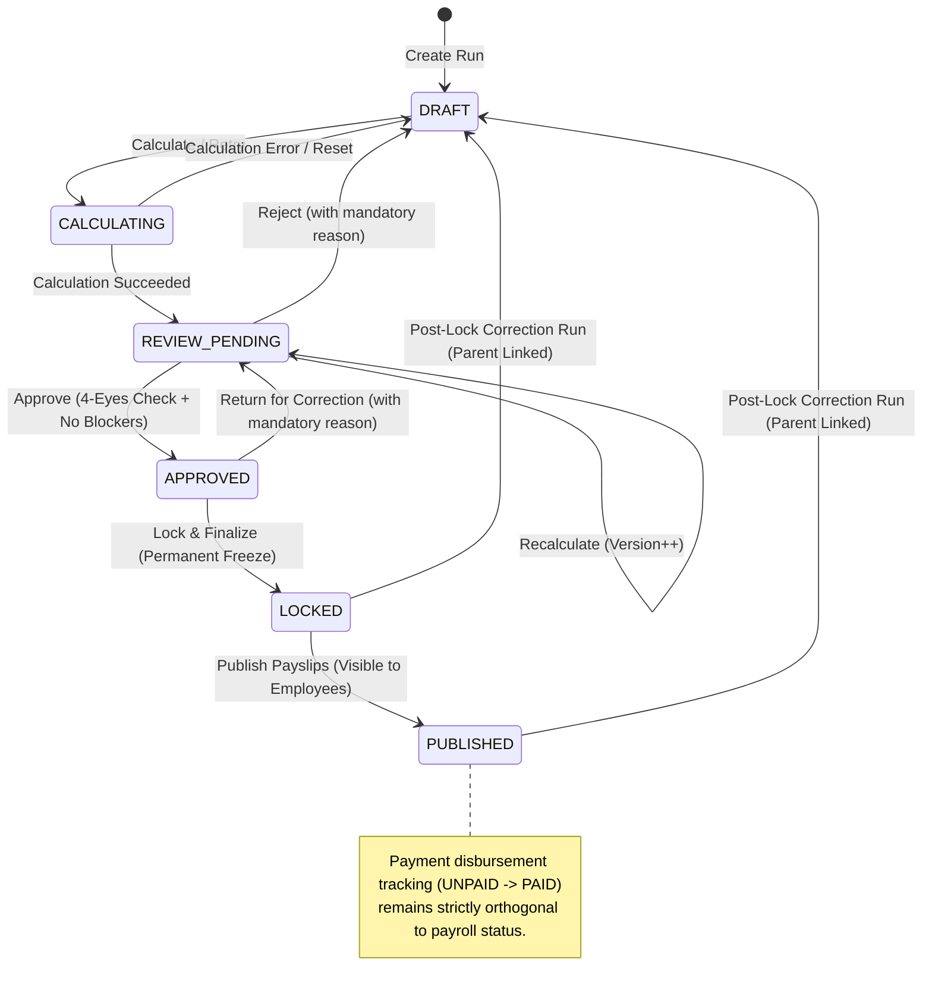

# Phase 11.8: Payroll Review, Approval, Locking, and Publishing Workflow

## 1. Executive Summary & Purpose

Phase 11.8 establishes an immutable, auditable, and segregation-of-duties-enforced approval and finalization lifecycle for payroll runs. It prevents self-approvals, halts workflows on blocking validation exceptions or post-calculation input modifications, permanently freezes finalized financial snapshots, and cleanly decouples payslip publication from treasury disbursements.

---

## 2. Permitted State Transitions & State Machine



### Transition Matrix

| Source Status    | Permitted Action      | Destination Status | Required Permission | Required Conditions / Gating                                                                                                                                                                                   |
| ---------------- | --------------------- | ------------------ | ------------------- | -------------------------------------------------------------------------------------------------------------------------------------------------------------------------------------------------------------- |
| `DRAFT`          | Calculate Run         | `CALCULATING`      | `PAYROLL_MANAGE`    | Period is OPEN or PROCESSED                                                                                                                                                                                    |
| `CALCULATING`    | Complete Batch        | `REVIEW_PENDING`   | System / Engine     | All employee snapshots computed                                                                                                                                                                                |
| `REVIEW_PENDING` | Reject Run            | `DRAFT`            | `PAYROLL_APPROVE`   | Mandatory `rejectionReason` provided                                                                                                                                                                           |
| `REVIEW_PENDING` | Recalculate           | `REVIEW_PENDING`   | `PAYROLL_MANAGE`    | Increments `calculationVersion`                                                                                                                                                                                |
| `REVIEW_PENDING` | Approve Run           | `APPROVED`         | `PAYROLL_APPROVE`   | **1.** Independent approver (`createdById !== actorId` & `calculatorId !== actorId`).<br>**2.** 0 unresolved blocking errors.<br>**3.** No material late attendance or adjustment changes post-`calculatedAt`. |
| `APPROVED`       | Return for Correction | `REVIEW_PENDING`   | `PAYROLL_APPROVE`   | Mandatory `reason` and audit log entry. Unlocks run for revision.                                                                                                                                              |
| `APPROVED`       | Lock & Finalize       | `LOCKED`           | `PAYROLL_APPROVE`   | Permanently freezes all calculation snapshots and line items.                                                                                                                                                  |
| `LOCKED`         | Issue Correction Run  | `DRAFT` (New Run)  | `PAYROLL_APPROVE`   | Mandatory legal/operational `correctionReason`. Links `parentRunId`.                                                                                                                                           |
| `LOCKED`         | Publish Payslips      | `PUBLISHED`        | `PAYROLL_MANAGE`    | Updates snapshot `payslipStatus: PUBLISHED`. Does NOT alter `paymentStatus`.                                                                                                                                   |

---

## 3. Review Interface Architecture

The Payroll Review Interface (`/payroll/runs/[id]`) provides decision-makers with comprehensive visibility prior to sign-off:

1. **Executive Overview & Scope Parameters:**
   - Payroll Period (`year`, `month`, start/end dates, cutoff date).
   - Headcount processed vs. eligible scope.
   - Processing status and calculation version (`v1`, `v2`, ...).
   - Initiator identity (`createdBy`) and timestamp.
2. **Separately Labeled Financial Totals (4-Pillar Totals):**
   - **Gross Earnings**: Sum of all employee earnings.
   - **Employee Deductions**: Total statutory & voluntary employee deductions.
   - **Net Payable**: Net salary transferred to employees.
   - **Employer Costs (CTC Impact)**: Employer PF, ESI, gratuity, and insurance contributions.
3. **Four-Eyes Governance & Separation of Duties Banner:**
   - Real-time indicator displaying whether the authenticated viewer is eligible to approve or blocked due to self-review restrictions.
4. **Validation Exceptions & Gating:**
   - Blocking errors count (blocks sign-off until resolved or overridden with audit remarks).
   - Review warnings count (preserved in the audit history upon approval).
5. **Department-Level Cost Summaries:**
   - Tabulated department breakdown: headcount, total gross, deductions, net pay, and employer contributions.
6. **Period-over-Period Variance & Trend Comparison:**
   - Compares metrics against the prior comparable payroll period.
   - Headcount delta, gross earnings variance %, net pay delta %, employer cost growth.
7. **Movements & Key Drivers:**
   - **New Joiners**: Mid-period additions.
   - **Exits**: Employees departed during the period.
   - **Compensation Revisions**: Employees with pay grade/structure adjustments.
   - **Manual Adjustments**: Ad-hoc incentives, travel reimbursements, or penalties applied.

---

## 4. Security & Separation of Duties Policy

1. **No Admin Bypass:**
   - The `ADMIN` role is subject to all separation of duties rules. If an Admin creates a payroll run or triggers calculation, that Admin **cannot** approve the run. An independent user with `PAYROLL_APPROVE` permission must review and sign off.
2. **Material Changes Gating:**
   - If late attendance, approved leaves, WFH requests, or compensation adjustments occur between `calculatedAt` and approval, approval is rejected with `BadRequestException`. The administrator must recalculate the run before approval can proceed.
3. **Concurrency Protection:**
   - Approvals, rejections, returns-for-correction, and locks are executed inside Prisma database transactions with atomic status validation (`ConflictException` thrown upon concurrent collisions).
4. **Permanent Freezing:**
   - Once a payroll run reaches `LOCKED`, all snapshots and items are immutable. Any attempt to modify snapshots directly triggers `BadRequestException` ("Payroll run is finalized and immutable...").
5. **Decoupled Payment Tracking:**
   - Publishing payslips sets snapshot `payslipStatus = PUBLISHED`, enabling ESS visibility. The `paymentStatus` remains `UNPAID` until dedicated disbursement processing.

---

## 5. Synthetic Demonstration Records

### Synthetic Scenario 1: Regular Run Approval & Locking

```json
{
  "payrollRun": {
    "id": "run-synth-2026-10-01",
    "title": "October 2026 Regular Corporate Payroll",
    "periodId": "period-2026-10",
    "scope": "ALL",
    "runNumber": 1,
    "calculationVersion": 1,
    "status": "APPROVED",
    "createdById": "usr-hr-initiator-01",
    "createdByName": "Priya Sharma (HR Operations)",
    "calculatedAt": "2026-10-26T14:30:00.000Z",
    "totalEmployees": 125,
    "totals": {
      "totalGross": 12500000.0,
      "totalDeductions": 1875000.0,
      "totalNet": 10625000.0,
      "totalEmployerCost": 1500000.0
    },
    "approvalDecision": {
      "action": "APPROVED",
      "actorId": "usr-fin-dir-02",
      "actorName": "Vikram Patel (Finance Director)",
      "decidedAt": "2026-10-27T10:15:00.000Z",
      "comments": "Audited against Q3 operating budget. Verified all 125 active employees.",
      "preservedWarnings": 2
    }
  }
}
```

### Synthetic Scenario 2: Separation of Duties Enforcement

```json
{
  "attemptedAction": "APPROVE_RUN",
  "actorId": "usr-hr-initiator-01",
  "actorRole": "ADMIN",
  "payrollRun": {
    "id": "run-synth-2026-10-01",
    "createdById": "usr-hr-initiator-01"
  },
  "outcome": "REJECTED_400_BAD_REQUEST",
  "policyEnforcement": "Separation of duties violation: A user cannot approve a payroll run they created. Independent approval is required."
}
```

### Synthetic Scenario 3: Controlled Post-Lock Correction Run

```json
{
  "parentRun": {
    "id": "run-synth-2026-10-01",
    "status": "LOCKED",
    "lockedById": "usr-fin-dir-02",
    "lockedAt": "2026-10-27T11:00:00.000Z"
  },
  "correctionRun": {
    "id": "run-synth-2026-10-02-corr",
    "title": "Correction: October 2026 Regular Corporate Payroll (Run #2)",
    "parentRunId": "run-synth-2026-10-01",
    "runNumber": 2,
    "status": "DRAFT",
    "createdById": "usr-hr-initiator-01",
    "correctionReason": "Retrospective board-approved Diwali incentive adjustment for Logistics department",
    "notes": "Supplementary run affecting 14 logistics employees."
  }
}
```
